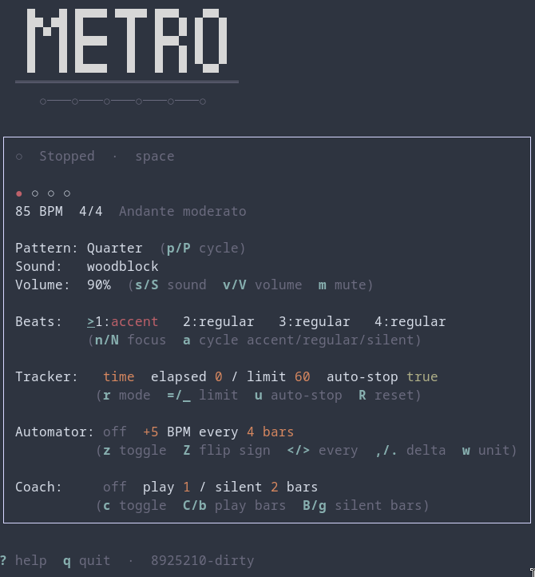

# Metro

[](https://github.com/dixiedream/metro/releases)
[](https://go.dev/)
[](LICENSE)
[](https://github.com/dixiedream/metro/releases)
[](https://github.com/charmbracelet/bubbletea)

Terminal metronome built in Go with [Bubble Tea](https://github.com/charmbracelet/bubbletea).

<p align="center">
  
</p>

## Features

- BPM 10–400, tap tempo, Italian/classical tempo markings
- Time signatures: 1–13/2, 1–13/4, 3/8, 5/8, 6/8, 7/8, 9/8, 12/8
- 6 simple + 3 compound rhythm patterns; per-beat accent / mute
- Visual beat LEDs in the terminal
- Practice tracker (bars or time) with auto-stop
- Automator (±BPM every N bars/seconds)
- Coach mode (play/silent bar alternation)
- 13 click sound sets + volume/mute
- Single-screen UI: tempo, beat accents, tracker, automator, and coach
- Optional MIDI foot-controller bindings

## Install

```bash
go install github.com/dixiedream/metro/cmd/metro@latest
```

Or from this repo:

```bash
go build -o metro ./cmd/metro
./metro
```

Requires a working audio output (oto/v3).

Pre-built binaries for Linux (amd64, arm64), macOS (Intel and Apple silicon), and Windows (amd64) are attached to [GitHub Releases](https://github.com/dixiedream/metro/releases). Pushing any git tag triggers the release workflow that builds those archives.

## Terminal colors

The UI picks up your terminal palette from `xrdb -query` (loaded X resources) and, if needed, `~/.Xresources` or `~/.config/Xresources`. Beat LEDs and borders use those ANSI colors. Set `NO_COLOR` to keep the plain monochrome UI.

## Config

Stored under `$XDG_CONFIG_HOME/metro` (default `~/.config/metro/`):

| File | Purpose |
|------|---------|
| `settings.json` | Live config, tracker/automator/coach, MIDI bindings |

### MIDI

Edit `settings.json`:

```json
"midi": {
  "enabled": true,
  "device_name": "",
  "play_pause": 36,
  "tempo_up": 38,
  "tempo_down": 40
}
```

Note numbers are MIDI note-on keys (empty `device_name` uses the first input port).

## Keys

Press `?` inside the app for the full map. Highlights:

| Key | Action |
|-----|--------|
| `space` | Play / pause |
| `↑` `↓` / `j` `k` / `+` `-` | BPM ±1 (Shift ±5) |
| `t` | Tap tempo |
| `[` `]` | Time signature |
| `p` | Rhythm pattern |
| `s` | Sound set |
| `m` | Mute |
| `n` / `a` | Beat focus / accent cycle |
| `r` / `z` / `c` | Tracker / automator / coach |
| `q` | Quit |

## Regenerate click samples

```bash
go run scripts/gensounds.go
```

## License

MIT
